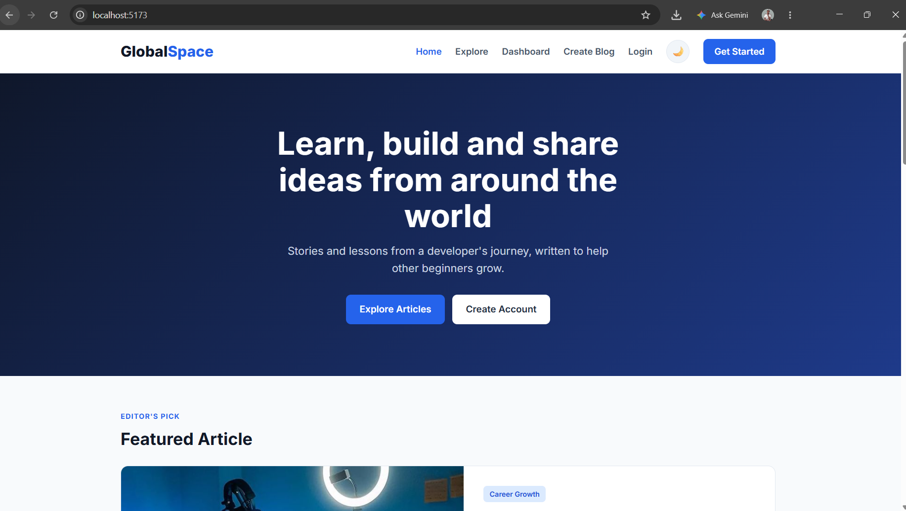
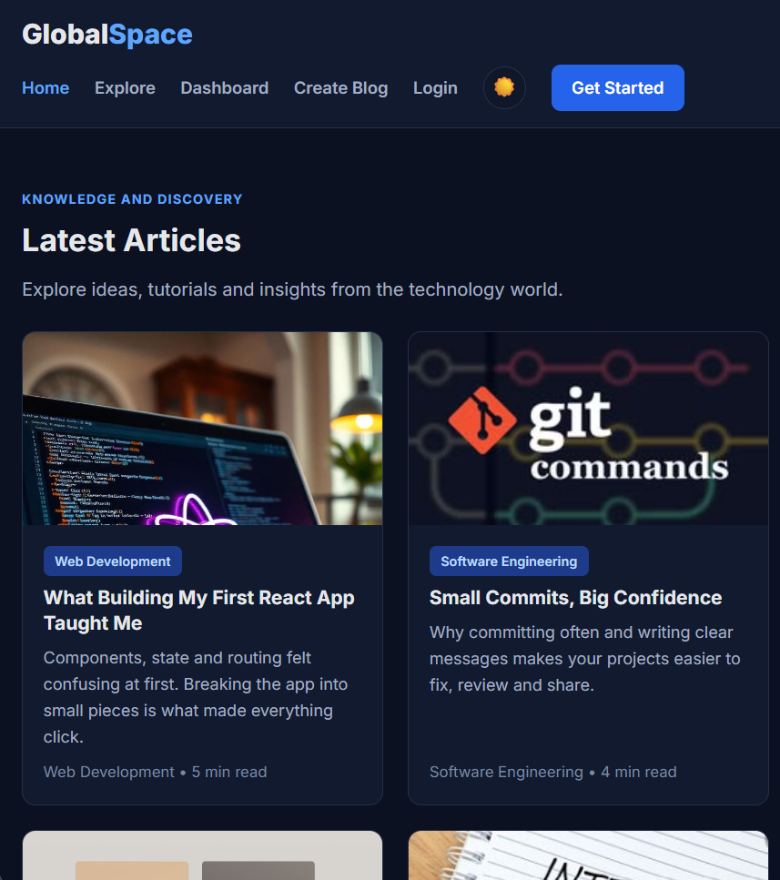

# GlobalSpace

A responsive blog application frontend built with React and Vite. It was created for Module 01 of my Codomax Digital Solutions virtual internship.

GlobalSpace is a place to read articles about technology and career growth, and to publish your own.

## Preview



| Dark mode                                 | Mobile view                              |
| ----------------------------------------- | ---------------------------------------- |
|  |  |

## Features

- Home page with a hero section, featured article, article grid, and popular categories
- Explore page listing all articles
- Register and Login forms with input handling
- Dashboard listing the user's blog posts
- Create Blog page with a title and content form
- Light and dark theme toggle that remembers your choice
- Client-side routing with React Router
- Fully responsive layout for desktop, tablet, and phone

## Tech Stack

- React
- Vite
- React Router
- CSS (Grid, Flexbox, CSS variables)

## Getting Started

1. Clone the repository:
   ```bash
   git clone https://github.com/Maxwel12744/codomax-blog.git
   ```
2. Go into the project folder:
   ```bash
   cd codomax-blog
   ```
3. Install dependencies:
   ```bash
   npm install
   ```
4. Start the development server:
   ```bash
   npm run dev
   ```
5. Open the local link shown in the terminal, usually `http://localhost:5173`.

## Project Structure

```
src/
  components/   Navbar, Footer, BlogCard
  pages/        Home, Explore, Login, Register, Dashboard, CreateBlog
  data/         Sample article data
  App.jsx       Routes and theme toggle
  App.css       Styles
  index.css     Theme colors and base styles
```

## What I Learned

- Building a multi-page app with React components and routing
- Managing form input with `useState`
- Creating a light and dark theme with CSS variables
- Designing a responsive layout with CSS Grid and media queries
- Using Git and GitHub with small, regular commits

## Notes

The forms currently use demo data only, and the articles are sample content. Backend integration with Node.js and Express comes in Module 02.

## Author

Maxwel Ochieng Odhiambo
Computer Science, Codomax Digital Solutions Virtual Internship
